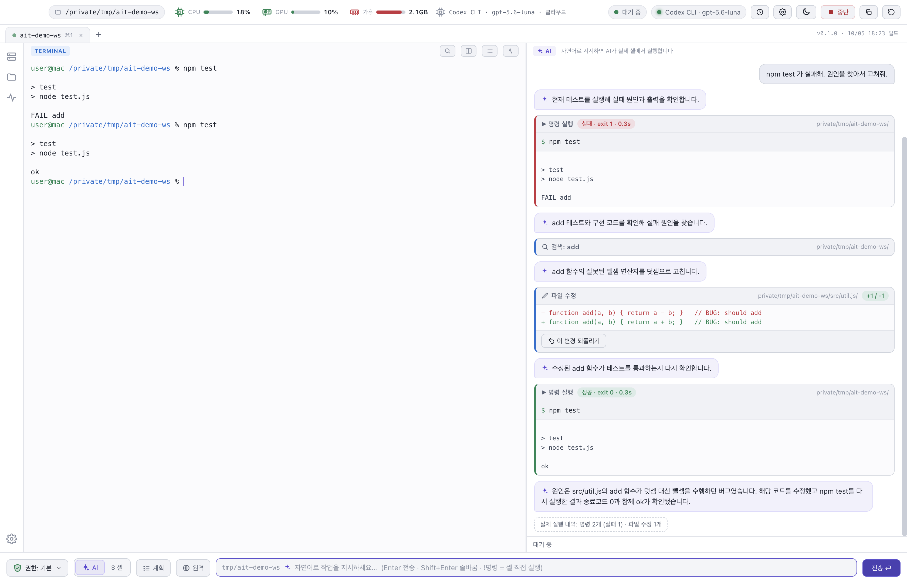
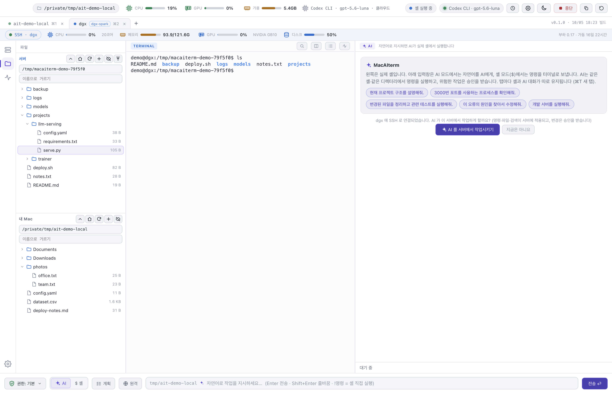

# MacAIterm

AI 에이전트를 내장한 macOS 터미널입니다. SSH 서버 모니터링과 파일 전송을 제공합니다.

[English](README.md)

## 다운로드

[Releases](https://github.com/NeuronLinkX/macAIterm/releases/latest) 페이지에서 최신 `.dmg`를 내려받으세요.

- macOS 13 이상, Apple 실리콘(M1 이상)
- 무료로 내려받아 사용할 수 있습니다. 계정과 텔레메트리가 없습니다.

### 설치

1. `.dmg`를 열고 **MacAIterm**을 **응용 프로그램** 폴더로 옮깁니다.
2. 자체 서명한 인증서로 서명했고 공증은 받지 않은 앱입니다. 처음 실행할 때는 응용 프로그램에서 앱을 우클릭하고 **열기**를 선택합니다. 그래도 막히면 시스템 설정 → 개인정보 보호 및 보안에서 **그래도 열기**를 선택합니다.
3. 선택 사항: `shasum -a 256 ~/Downloads/MacAIterm-<버전>-arm64.dmg` 결과가 릴리스 노트의 SHA-256과 일치하는지 확인합니다.
4. 집이나 사무실 네트워크의 서버에 접속하려면 macOS가 MacAIterm의 로컬 네트워크 사용을 허용해야 합니다. 앱이 그런 서버에 처음 접속할 때 macOS가 물으며(**허용**을 선택), **설정 → SSH · 원격 → 로컬 네트워크 허용 → 허용 요청**으로도 질문을 띄울 수 있습니다. 허용 안 함을 선택했다면 시스템 설정 → 개인정보 보호 및 보안 → 로컬 네트워크에서 켜세요.

설치나 업데이트 뒤에 macOS가 "MacAIterm Safe Storage" Keychain 항목을 물을 수 있습니다. 비밀번호는 직접 입력하고 **항상 허용**을 선택하세요. API 키를 저장하지 않는다면 거부해도 앱은 동작합니다.

## 기능

- **셸 안의 에이전트.** 에이전트는 지금 작업 중인 세션과 디렉터리에서 명령을 실행합니다. 파일을 읽고, 수정하고, 생성하며 모든 변경을 되돌릴 수 있는 diff로 보여 줍니다.
- **승인 절차.** 위험한 명령은 승인을 기다립니다. 권한 모드 4종, 비밀 정보 마스킹, 네트워크 차단 모드, 감사 로그를 제공합니다.
- **모델 제공자.** Ollama의 로컬 모델, OpenAI 호환 서버나 OpenAI API, 또는 ChatGPT 로그인을 쓰는 Codex CLI를 사용할 수 있습니다.
- **SSH 원격 작업.** 에이전트가 서버에서 작업할 수 있으며, 변경은 서버 이름이 표시된 승인을 거칩니다. 탭 아래 띠에 서버의 CPU, 메모리, GPU, 디스크가 표시됩니다.
- **세션과 파일 전송.** 세션 저장, `~/.ssh/config` 가져오기, 점프 호스트, X11과 포트 포워딩, 서버와 Mac의 파일 트리, SHA-256으로 검증하는 복사를 지원합니다.
- **`~/.ssh/config` 편집기.** 문법 검사, 이전 내용 백업, 충돌 검사가 있는 창에서 파일을 직접 고칩니다.
- **원격 화면(VNC).** 서버의 VNC 화면을 창 안에 띄웁니다. 화면은 탭의 SSH 연결 안으로만 흐르며, Mac에는 포트가 열리지 않고 VNC 비밀번호도 저장하지 않습니다. AI 채팅은 이 화면을 보거나 조작하지 못합니다.
- **AI 채팅 버튼.** AI 창과 입력줄을 함께 숨기거나 보입니다(⇧⌘A). 터미널이 창 전체를 쓸 수 있습니다.

## 모델

모델은 포함되어 있지 않습니다. 첫 요청 전에 [Ollama](https://ollama.com)(예: `ollama pull qwen3:8b`), OpenAI 호환 서버, Codex CLI 중 하나를 설정하세요. 로컬 모델은 대화가 Mac 안에 머물고, 그 밖의 선택지는 선택한 제공자에게 대화를 전송합니다.

## 문서

- [개인정보](PRIVACY.md)(영어): 로컬에 저장되는 것과 Mac 밖으로 전송될 수 있는 것
- [SSH 가이드](docs/SSH.md)
- [변경 내역](CHANGELOG.md)
- [서드파티 고지](THIRD_PARTY_NOTICES.md)

## 지원

- 버그, 기능 요청, 질문: [이슈 등록](https://github.com/NeuronLinkX/macAIterm/issues/new/choose). 이슈는 공개되므로 API 키, 비밀번호, 비공개 서버 정보는 먼저 삭제해 주세요.
- 보안 문제: [비공개 취약점 제보](https://github.com/NeuronLinkX/macAIterm/security/advisories/new)를 사용하세요. [SECURITY.md](SECURITY.md)를 참고하세요.

## 알려진 한계

- 자체 서명한 인증서로 서명했고 공증은 받지 않은 앱입니다.
- macOS가 로컬 네트워크 질문을 띄우지 않고 앱 안에서 내 네트워크의 서버로 `ssh` 할 때 `No route to host`가 나면, 터미널에서 `/Applications/MacAIterm.app/Contents/MacOS/MacAIterm`으로 앱을 한 번 실행해 보세요(터미널의 허용을 사용합니다).
- 아직 Intel 빌드는 제공하지 않습니다.
- SSH는 로컬 테스트 서버, Ubuntu VM, NVIDIA DGX Spark 한 대(로그인과 모니터링)에서 검증했습니다. 비밀번호 로그인만 되는 서버는 테스트하지 않았습니다.
- 원격 화면은 테스트용 VNC 서버와 Ubuntu VM의 TigerVNC 서버에서 검증했습니다. 다른 VNC 서버, 느린 회선, 소리, 파일 전송, 여러 모니터 선택은 확인하지 못했습니다.
