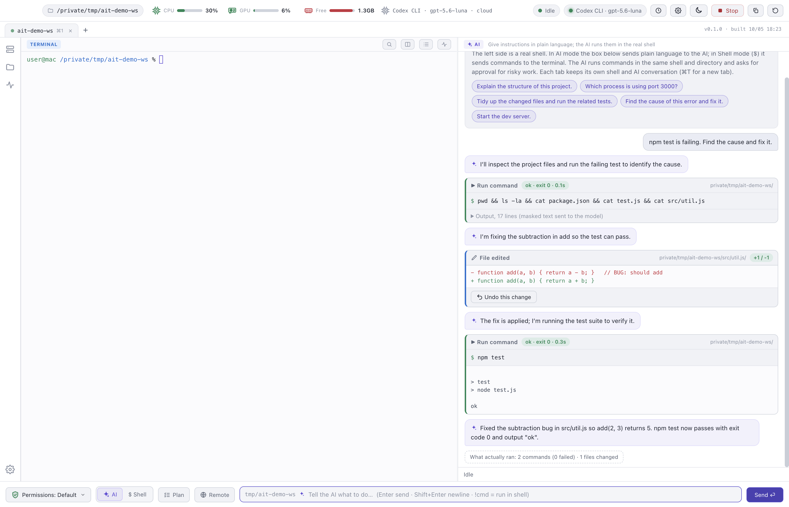
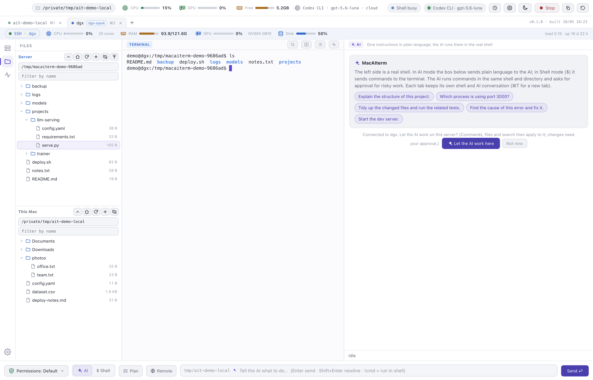

# MacAIterm

A macOS terminal with a built-in AI agent, server monitoring and file transfer over SSH.

[한국어](README.ko.md)

## Download

Get the latest `.dmg` from the [Releases](https://github.com/NeuronLinkX/macAIterm/releases/latest) page.

- macOS 13 or later, Apple silicon (M1 or later)
- Free to download and use. No account, no telemetry.

### Install

1. Open the `.dmg` and drag **MacAIterm** to **Applications**.
2. The app is signed with a self-signed certificate and is not notarized. On the first launch, right-click the app in Applications and choose **Open**. If macOS still blocks it, open System Settings → Privacy & Security and choose **Open Anyway**.
3. Optional: verify the download with `shasum -a 256 ~/Downloads/MacAIterm-<version>-arm64.dmg`. The result must match the SHA-256 in the release notes.
4. To reach servers on your home or office network, macOS must allow MacAIterm to use the local network. It asks the first time the app connects to such a server (click **Allow**), or you can trigger the question from **Settings → SSH · Remote → Local network access → Ask for access**. If you chose Don't Allow, switch it on in System Settings → Privacy & Security → Local Network.

After an install or update, macOS may ask about the "MacAIterm Safe Storage" Keychain item. Enter your password yourself and choose **Always Allow**. If you do not save API keys, you can deny it and the app still works.

## Features

- **An agent in your shell.** The agent runs commands in the same session and directory you are working in. It reads, edits and creates files, and shows every change as a diff that can be undone.
- **Approvals.** Risky commands wait for your approval. Four permission modes, secret masking, a network-block mode and an audit log are included.
- **Model providers.** Use a local model through Ollama, an OpenAI-compatible server or the OpenAI API, or Codex CLI with a ChatGPT login.
- **Remote work over SSH.** The agent can work on a server. Changes require an approval that names the server. A strip under the tabs shows the server's CPU, memory, GPU and disk.
- **Sessions and file transfer.** Saved sessions, `~/.ssh/config` import, jump hosts, X11 and port forwarding, and file trees for the server and your Mac with SHA-256 verified copies.
- **`~/.ssh/config` editor.** Edit the file in a window with a syntax check, backups of the previous content and a conflict check.
- **Remote screen (VNC).** Show a server's VNC desktop inside the window. The picture travels only through the tab's SSH connection: no port is opened on your Mac and the VNC password is never stored. The AI chat does not see or operate the screen.
- **AI chat button.** Hide or show the AI pane and its input bar together (Shift+Cmd+A) to give the terminal the whole window.

## Models

No model is bundled. Before the first request, set one up with [Ollama](https://ollama.com) (for example `ollama pull qwen3:8b`), an OpenAI-compatible server, or Codex CLI. Local models keep the conversation on your Mac. The other options send it to the provider you select.

## Documentation

- [Privacy](PRIVACY.md): what is stored locally and what can leave your Mac
- [SSH guide](docs/SSH.md) (Korean)
- [Changelog](CHANGELOG.md)
- [Third-party notices](THIRD_PARTY_NOTICES.md)

## Support

- Bugs, feature requests and questions: [open an issue](https://github.com/NeuronLinkX/macAIterm/issues/new/choose). Issues are public, so remove API keys, passwords and private server details first.
- Security problems: use [private vulnerability reporting](https://github.com/NeuronLinkX/macAIterm/security/advisories/new). See [SECURITY.md](SECURITY.md).

## Known limits

- The app is signed with a self-signed certificate and is not notarized.
- If macOS never shows the local network question and `ssh` to a server on your network says `No route to host` inside the app, start the app once from Terminal with `/Applications/MacAIterm.app/Contents/MacOS/MacAIterm` (it then uses Terminal's permission).
- No Intel build is available yet.
- SSH was exercised against a local test server, an Ubuntu VM and one NVIDIA DGX Spark (login and monitoring). Servers that only allow password login were not tested.
- The remote screen was exercised against a test VNC server and a TigerVNC server on an Ubuntu VM. Other VNC servers, slow connections, sound, file transfer and multi-monitor selection are not covered.
